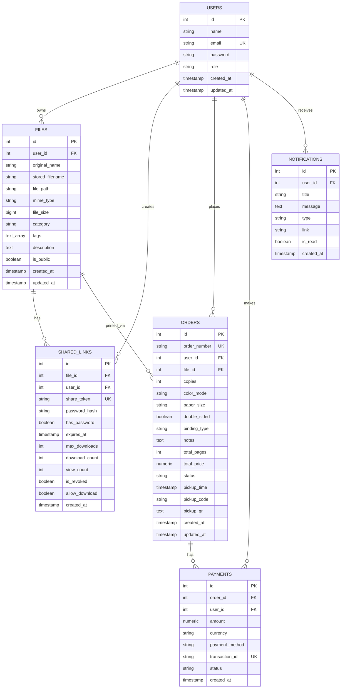

# DocDrop Database Design

DocDrop uses **PostgreSQL** as its relational database. The schema is designed for data integrity, cascading deletions for owned resources, and indexing on frequent access paths (tokens, user IDs, categories, and order statuses).

---

## Entity-Relationship (ER) Overview

---

## Tables Description

### 1. `users`
Stores user identities, credentials (hashed via bcrypt), and authorization roles (`user` or `admin`).

### 2. `files`
Stores file metadata, isolated internal storage filenames (`<uuid>.<ext>`), file size, MIME type, categories, user-assigned tags, and notes. Physical files are placed outside public HTTP static root in `backend/uploads/` and streamed strictly via authenticated/authorized controllers.

### 3. `shared_links`
Stores unguessable, 32-character crypto share tokens, optional bcrypt passcode hashes, optional expiration dates, download limit ceilings, and revocation flags.

### 4. `orders`
Manages the digital print drop queue. Includes customer choices (color vs B&W, paper format, duplex toggle, binding option), calculated pricing, order status lifecycle (`pending` -> `processing` -> `ready_for_pickup` -> `completed` -> `cancelled`), unique human-readable pickup codes, and QR verification payloads.

### 5. `payments`
Tracks simulated or live payment receipts, payment methods (UPI, Card, Wallet), and unique transaction IDs.

### 6. `notifications`
Delivers immediate in-app updates when share links are accessed, print jobs start, or when orders become ready for pickup.

---

## Key Performance Indexes
- `idx_files_user_id` on `files(user_id)`
- `idx_files_category` on `files(category)`
- `idx_shared_links_token` on `shared_links(share_token)`
- `idx_orders_user_id` on `orders(user_id)`
- `idx_orders_status` on `orders(status)`
- `idx_notifications_user_id` on `notifications(user_id)`
